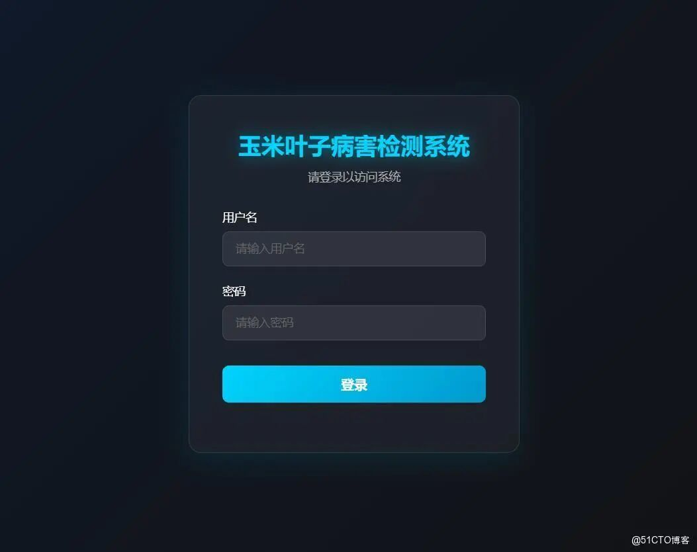
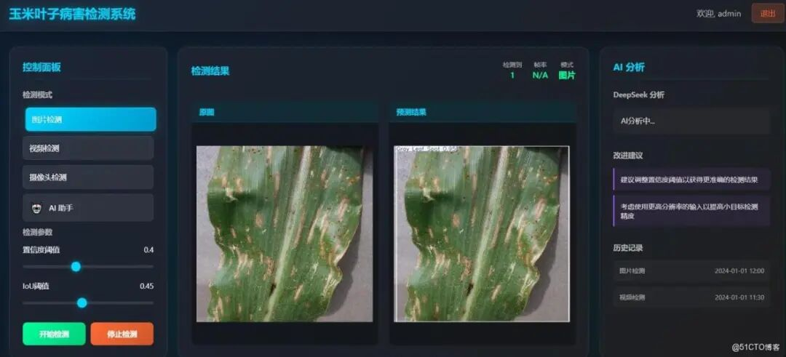
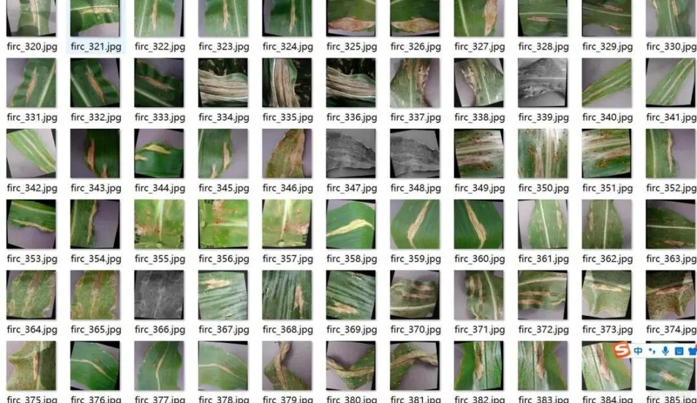
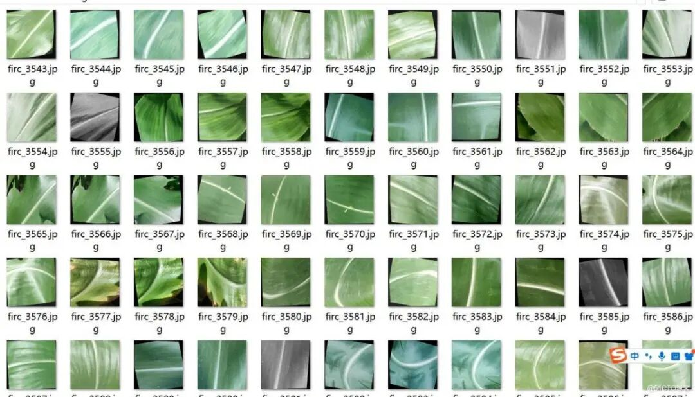
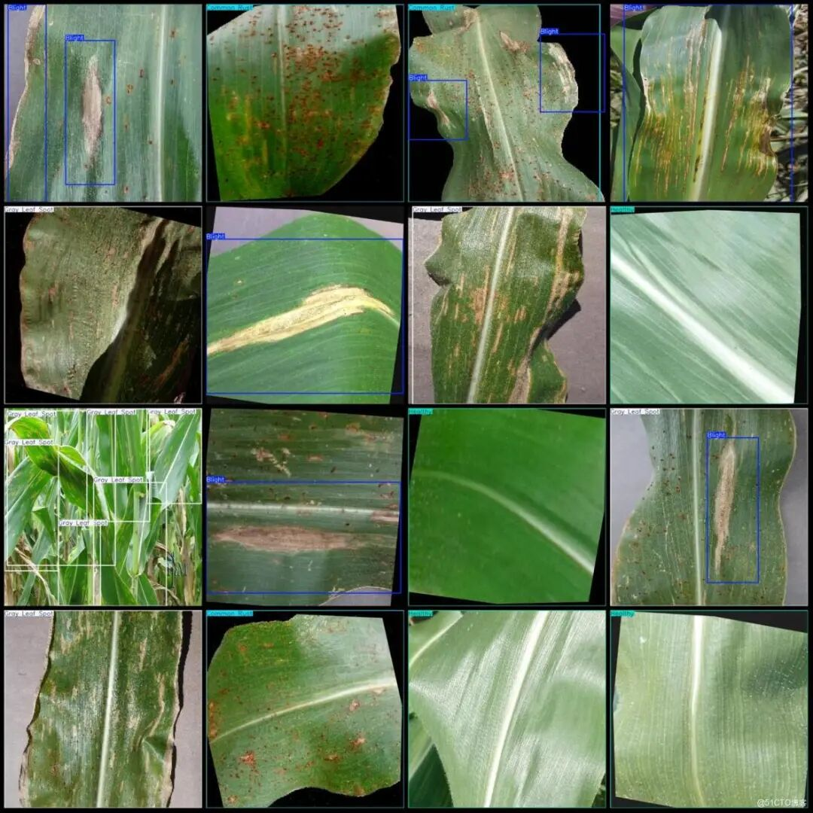

# Corn Leaf Disease Detection System Based on Yolov26+Django+DeepSeek with a Login Interface in Python Source Code + ONNX Model + Beautiful Web Interface

Effect Display: Login interface main interface based on YOLO26 target detection system, supports image, video and real-time camera detection, integrated DeepSeek.

## Effect Display

Login interface



Main Interface



A YOLO26-based object detection system, supporting image, video, and real-time camera detection, integrated with DeepSeek AI analysis capabilities.

### Functional Characteristics

-

Image target detection

-

Video file detection

-

Real-time camera detection

-

DeepSeek AI Intelligent Analysis

-

Adjustable detection parameters (confidence, IoU)

-

Beautiful user interface

-

The AI assistant is integrated to enable conversation with the AI.

### [Test Environment]

windows10

anaconda3+python3.10

torch == 2.3.1

ultralytics == 8.4.7

Django == 5.2.11

onnxruntime == 1.17.0

### Model can detect 4 categories

['Blight', 'CommonRust', 'GrayLeafSpot', 'Healthy']

### Training dataset introduction

Dataset format: YOLO format (txt file without split path, only contains jpg images and corresponding yolo format txt files)

Number of images (number of jpg files): 4209

Number of annotations (number of txt files): 4209

Number of training set: 3684

Number of validation set: 350

Number of test sets: 175

Label category count: 4

Label category names (note that the order of yolo format categories does not correspond to this, but is based on the 'labels' folder with 'classes.txt'): ['Blight', 'Common Rust', 'Gray Leaf Spot', 'Healthy']

Number of boxes labeled in each category:

Blight (Wilted/Leaf Blight) Frames = 1502

Common Rust (common rust) frame count = 1512

Gray Leaf Spot (gray spot) frame count = 1484

Healthy (health) frame count = 1013

Total frame count = 5511

Using labelImg:

Annotation rules: Draw a rectangle around the category.

Important Notice: No

Special : This dataset does not guarantee the accuracy of the trained models or weight files.





Annotation example:



[Training Information]

Number of training set images = 3684

Number of validation set images = 351

Training map = 77.3%

Training Accuracy = 84.8%

Training recall rate (Recall) = 72.3%

[Verification set accuracy]


Class


Images


Instances


P


R


mAP50


mAP50-95


all


351


463


0.848


0.723


0.773


0.636


Blight


99


133


0.748


0.602


0.658


0.326


Common Rust


97


121


0.907


0.711


0.784


0.665


Gray Leaf Spot


85


119


0.754


0.58


0.655


0.561


Healthy


90


90


0.983


1


0.995


0.994


### Install Dependencies

```
pip install -r requirements.txt
```

### Database Migration

```
python manage.py makemigrations
python manage.py migrate
```

### Running Projects

```
python manage.py runserver
```

Visit http://127.0.0.1:8000

### Default login information

-

Username: admin

-

Password: admin

### Main File Structure of the Project

```
yolo26-django-deepseek-det-system/
├── manage.py                 # Django Project Management Script
├── requirements.txt  # Project dependency package list
├── README.md  # Project Description Document
├── index.html  # Main page (as a backup or example page)
├── start_lan.bat  # A one-click batch script for starting the system
├── yolo_detection/ # Django project configuration directory
├── __init__.py
├── settings.py # Project configuration file (database, API key, etc.)
├── urls.py # Project's total route configuration
└── wsgi.py # WSGI deployment configuration
├── detection/ Detection function application module
├── __init__.py
├── apps.py # Application configuration
├── forms.py # Form definition (such as file upload form)
├── models.py
├── urls.py # Detection of application route configuration
└── views.py # Core view functions (YOLO detection logic, file processing, etc.)
├── templates/ # Web page template directory
├── index.html # Main operation interface (upload, detection, result display)
└── login.html # Login Page
├── media/ # Media file storage directory
└── uploads/ # Directory for storing uploaded files by users
├── test_img/ # Test image directory
└── *.jpg # Detection sample images
├── weights/  # Model and training log directory
```

### Technology Stack

-

Django 4.2+

-

YOLO26 (Ultralytics)

-

OpenCV

-

DeepSeek API

-

Chart.js

-

HTML5/CSS3/JavaScript

### Notes

-

Ensure that the `yolov26n.onnx` model file is in the project's weights directory.

-

DeepSeek API key needs to be configured in `settings.py`

-

Recommend using Python 3.8+

### Common Evaluation Parameters Introduction

In the task of object detection, evaluating the performance of a model is crucial. The terms you mentioned are commonly used metrics for assessing the performance of a model. Here are detailed explanations of these terms:

Class: This typically refers to the category of objects that the model is designed to detect. For example, a model may be trained to detect different categories of objects such as vehicles, pedestrians, or animals.

Images: Represents the number of images in the validation set. The validation set is a dataset used to evaluate model performance, separate from the training set to ensure fairness in evaluation results.

Instances: The total number of target objects in all images. This includes the sum of all category objects, for example, if the validation set contains 100 images, each image has an average of 5 target objects, then Instances is 500.

P (Precision): Precision is the proportion of true positives among the instances predicted as positive by the model. The formula is: Precision = TP / (TP + FP), where TP represents true positives and FP represents false positives.

R (Recall): Recall is the proportion of all true positives correctly predicted by the model. The formula is: Recall = TP / (TP + FN), where FN represents false negatives.

mAP50: It represents the mean average precision (mean Average Precision) at an IoU (Intersection over Union) threshold of 0.5. The IoU is a metric used to measure the degree of overlap between predicted bounding boxes and ground truth bounding boxes. mAP is a comprehensive metric that considers both precision and recall, used to evaluate the performance of models across different recall levels. At an IoU of 0.5, if the overlap between the predicted bounding box and the ground truth bounding box reaches or exceeds 50%, it is considered correct.

mAP50-95: Refers to the average precision of a model within the range of IoU from 0.5 to 0.95 (with a step of 0.05). This is a more stringent evaluation criterion, demanding higher overlap between predicted bounding boxes and true ones. In object detection tasks, higher IoU thresholds mean that models need to be more accurate in target object localization. The computation of mAP50-95 takes into account multiple IoU thresholds ranging from lenient to strict, thus providing a comprehensive assessment of model performance. These metrics collectively form an important framework for evaluating the performance of object detection models. By comparing the performance of different models on these metrics, one can determine which model might be more effective in practical applications.

### Common Issues

In target detection training, a low Mean Average Precision (MAP) may be due to one of the following reasons:

Reason two: Small Objects: If the dataset contains a large number of small objects, it is likely to result in a low map value. This is because the features of small objects are not distinct, making it difficult for the model to learn them.

Reason 3: Mismatched model tuning parameters: For instance, if the learning rate is adjusted too high, it may lead to an overly rapid learning capability, resulting in disordered adjustments of model parameters.

Reason 4: Overfitting (This is now a rare occurrence in models): If the model performs exceptionally well on training data but poorly on validation or test data, it may be due to overfitting. This is often caused by an excessive number of model parameters relative to the amount of training data available, leading the model to learn noise or specific patterns from the training data and fail to generalize to new data. Nowadays, target detection models are well-equipped to handle this situation, with very few instances of overfitting occurring.

Reason 5: Different scenes: The validation set has high accuracy, but the test set does not, which may be due to inconsistencies between the training model's scene images and those in the test map. To address these issues, the following measures can be taken to improve MAP:

(1) Optimize model structure: Select the appropriate model based on the characteristics of the task and dataset, and try using different network architectures and components to improve model performance.

(2) Enhance Data Preprocessing: Proper preprocessing and enhancement of data, such as data normalization, missing value imputation, data expansion, etc., to enhance the generalization ability of the model.

(3) Adjusting the Loss Function: Try using different loss functions or combining multiple loss functions to optimize model performance.

(4) Optimize training strategies: Adjust hyperparameters such as learning rate, batch size, and number of training iterations, and use optimization algorithms like learning rate decay and momentum to improve the model training performance.

(5) Use pre-trained models: Transfer learning using pre-trained models on large datasets can accelerate model convergence and improve performance. (6) Increase the number of datasets

### Provided documents

Python source code

YOLOv2.6n.onnx model (provided as PyTorch model)

Training map, P, R curve graph (in weights\results.png)

Test images (under test_img folder)

Please note that the dataset is provided in the dataset_address.xlsx file.


## Payment

Here is a pay link on Stripe ( https://buy.stripe.com/3cs8yP7sY87d0vu9AB ). Please contact me lonlonago@foxmail.com after funding $89, and I will send you a complete data files , thank you!


